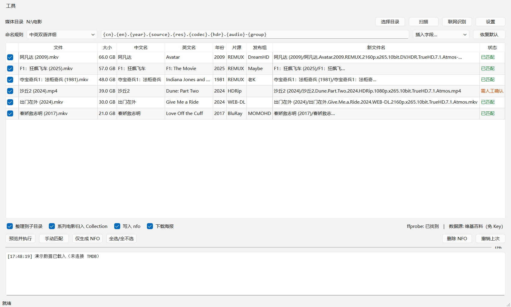

# MediaShelf · 影视库整理

[](https://github.com/szjmhxd/media-shelf/releases/latest)
[](https://github.com/szjmhxd/media-shelf/actions/workflows/test.yml)


一个本地运行的桌面工具，把散乱的影视文件整理成媒体库能识别的结构：批量改名、按影片归档、写入或删除 nfo。所有操作在本地完成，只做同盘改名，不搬运数据。



## 它解决什么

下载来的片名常常是三种体系混在一起：场景名（`Avatar.2009.2160p.BluRay.x265-DreamHD.mkv`）、站点头（`【高清影视之家发布】...`）、以及只有中文裸名（`沙丘2.mp4`）。这类文件直接丢进 Emby、Jellyfin、Kodi，轻则不显示海报，重则同一个系列被拆成七八个条目。

MediaShelf 的做法是：先用 ffprobe 读出真实参数，再用 TMDB 查出中英文名与元数据，最后按你设置的规则渲染文件名。

| 能力 | 说明 |
|---|---|
| 重命名 | 模板化命名，字段可插拔，实时预览新名字 |
| 整理文件夹 | 电影按 `片名 (年份)` 归档，剧集按 `剧名 (年)/Season XX/剧名 - SxxExx` 归档，系列电影归入 `XXX Collection` |
| 剧集支持 | 自动区分电影与剧集，识别四种集号格式，TMDB TV 接口取中英文名与集标题 |
| 设置 / 删除 nfo | 生成 Kodi 标准 `movie.nfo` / `tvshow.nfo` / 每集 nfo，可同步下载 poster / fanart |
| 撤销 | 每次执行写一份 CSV 日志，一键按日志反向还原 |

## 安装

### 直接下载（推荐）

到 [Releases](https://github.com/szjmhxd/media-shelf/releases) 下载 `MediaShelf.exe`，双击运行，不需要装 Python。

单文件版首次启动要解压到临时目录，会卡 3～8 秒，之后就快了。程序会自己找 ffprobe（PATH、`C:\ffmpeg\bin`、`D:\environment\ffmpeg\bin` 等常见位置）；找不到时在「设置」里手动指定 `ffprobe.exe` 路径。ffmpeg 可以用 `winget install Gyan.FFmpeg` 安装。

### 从源码运行

需要 Python 3.9 以上，以及 ffmpeg（提供 ffprobe）。

```bash
git clone https://github.com/szjmhxd/media-shelf.git
cd media-shelf
pip install -r requirements.txt
python run.py
```

Windows 上 ffmpeg 可以用 `winget install Gyan.FFmpeg`，程序也会自动探测常见安装路径；找不到时在「设置」里手动指定 `ffprobe.exe` 即可。

## 快速开始

1. 点「选择目录」，指向媒体库根目录（例如 `N:\电影`）。
2. 点「扫描」，程序递归找出视频并逐个读取编码参数。55 个文件大约十几秒，取决于磁盘。
3. 点「联网识别」，按目录名优先、文件名兜底的顺序提取查询词，去 TMDB 匹配。中文译名和 TMDB 官方译名对不上时（如《长发公主》=《魔发奇缘》），自动拿文件名里的原名段补搜；`真人版` 这类 TMDB 标题里没有的后缀会剥掉重搜。
4. 检查表格中的「中文名 / 英文名 / 年份」，不准确的行选中后点「手动匹配」重新搜索。
5. 点「预览并执行」，确认操作清单后执行。改名完成后可让媒体库刷新。

表格中的中文名、英文名、年份、片源、发布组都可直接双击编辑，改完立刻反映到「新文件名」列。

## 命名规则

模板里用 `{字段}` 占位，分隔符自己定。默认模板：

```
{cn}.{orig}.{year}.{source}.{res}.{codec}.{hdr}.{audio}-{group}
```

渲染结果：

```
疯狂动物城.Zootopia.2016.BluRay.2160p.x265.10bit.DV.HDR.TrueHD.7.1.Atmos-DreamHD.mkv
碧蓝之海.ぐらんぶる.2018.BDRip.1080p.x265.10bit-DBD-Raws.mkv
```

第二段 `{orig}` 按作品语言挑名字：日本动画出日文原名（`ぐらんぶる`），英语片出英文名（`Zootopia`），韩国片出韩文原名。判断依据是 TMDB 的 `original_language` 字段，不猜文本里有没有假名。中文作品的原名就是中文，会和第一段重复，此时退化成英文名。想要一律用英文，把第二段换成 `{en}`。

| 字段 | 含义 | 来源 |
|---|---|---|
| `{cn}` | 中文片名 | TMDB `title`（zh-CN） |
| `{orig}` | 语言原名 | `original_language` 为中文时取英文名，否则取原名 |
| `{en}` | 英文片名 | TMDB alias 中的 US/GB 标题 |
| `{year}` | 上映年份 | TMDB `release_date` |
| `{res}` | 2160p / 1080p / 720p | ffprobe 实际宽高 |
| `{source}` | BluRay / REMUX / WEB-DL / HDRip | 原文件名优先，缺失时按码率与体积推断 |
| `{codec}` | x265.10bit / x264 / AV1 | ffprobe 编码与色深 |
| `{hdr}` | DV.HDR / DV / HDR / HLG | ffprobe 色彩传输特性与 DOVI 侧数据 |
| `{audio}` | TrueHD.7.1.Atmos / DTS-HD.MA.5.1 / DDP.5.1 | ffprobe 音轨，按规格取最佳一条 |
| `{group}` | 发布组 | 文件名 `-` 之后的片段 |
| `{edition}` | EXTENDED / PROPER / IMAX | 文件名中的版本标记 |
| `{collection}` | 系列名 | TMDB `belongs_to_collection` |
| `{season}` | 季（剧集） | 01、02…，由文件名或父目录解析 |
| `{episode}` | 集（剧集） | 01、02… |
| `{ep_title}` | 集标题（剧集） | TMDB season 接口 |

内置四套预设：媒体库简洁、中英双语详细、标准场景命名、仅英文。改过的模板会显示为「自定义」。

归一化规则：空字段不会留下连续的点；中英文名相同时只保留一份；`:`、`/`、`*`、`?` 等非法字符会被替换；点分隔模板中标题内部的空格也转成点，避免 `Dune Part Two` 混进 `Dune.Part.Two` 的结构里。

## 数据源

| 数据源 | 需要 Key | 能拿到 | 适用 |
|---|---|---|---|
| TMDB | 是（免费） | 中英文名、年份、简介、评分、类型、导演、演员、TMDB/IMDb ID、海报、系列归属 | 推荐 |
| Wikidata | 否 | 中文名、英文名、年份、IMDb ID、海报、一句话简介 | 没有 Key 时的兜底 |

TMDB 的免费 Key 申请：注册后进入 设置 → API → 申请开发者权限，通过后复制 v3 Key（32 位）或 v4 Read Access Token（`eyJ` 开头）。两种都能直接粘进「设置」，程序按前缀判断。

**免 Key 的 Wikidata 命中率明显偏低**，原因很具体：它的中文标签覆盖率不足。`冰海陷落` 在 Wikidata 里只有港译《潛艦獵殺令》，`不要见怪` 只有《調教你處男》，程序靠标题相似度对不上就只能放弃。实测 10 部片子大约能命中 3 部，而且 Wikimedia 对连续请求有速率限制，批量识别时会遇到 429。要正经整理整库，还是申请 TMDB Key。

**需要知道的限制**：TMDB 与 Wikidata 都在境外，部分网络环境需要代理才能访问。程序对 `401 / 429 / 超时` 都有明确提示，失败只影响识别，不影响改名与整理——片名和年份会从文件名就地解析，改名不依赖联网。

## nfo 说明

生成的 `movie.nfo` 是 Kodi 标准格式，Jellyfin、Emby、Kodi 都能读：

```xml
<movie>
  <title>阿凡达</title>
  <originaltitle>Avatar</originaltitle>
  <year>2009</year>
  <tmdbid>19995</tmdbid>
  <uniqueid type="tmdb" default="true">19995</uniqueid>
  <plot>…</plot>
  <art><poster>poster.jpg</poster><fanart>fanart.jpg</fanart></art>
</movie>
```

图片写相对文件名，不用绝对路径。原因很实际：网上流传的 nfo 常把 `<poster>` 写成发布者自己 NAS 上的路径，换一台机器就全部失效。

删除 nfo 时默认先复制到库根目录的 `_nfo_backup`，再删原文件；该目录不在媒体库扫描范围内。

## 剧集整理

剧集走 TMDB 的 TV 接口（`/search/tv`、`/tv/{id}`、`/tv/{id}/season/{n}`），和电影是两套数据。自动区分电影与剧集的规则：

**同一个目录里出现 ≥2 个不同集号才算剧集。** 单个文件就算名字里带「01」也可能是《101忠狗》这类片名，误判成剧集会把电影搬进 Season 01，收拾起来比重命名麻烦得多。

集号支持四种格式，实测一个 333 文件的库里 `SxxExx` 出现 0 次，反倒是这四种到处都是：

| 格式 | 例子 | 来源 |
|---|---|---|
| 纯数字 | `01.flv` | 老番、FLV 片源 |
| 方括号 | `[DBD-Raws][Grand Blue][01][1080P].mkv` | 字幕组 |
| 中文序号 | `第01话 那就是恋情的开端 4K.mp4` | B 站片源 |
| 末尾数字 | `HUNTER×HUNTER(2011) 001.mkv` | 重制版 |
| 分隔符夹着 | `Dan Da Dan - 01 [IQIYI WebRip].mkv` | 合并包拆分 |

季号从文件名或父目录找：`第二季 抢先版`（中文数字）、`胆大党S01`、`Season 02` 都认。

整理后的结构是 Jellyfin / Emby / Kodi 通用的：

```
碧蓝之海 (2018)/
  tvshow.nfo          ← 剧级元数据，整部剧只写一次
  poster.jpg
  fanart.jpg
  Season 01/
    S01E01.nfo
    碧蓝之海.ぐらんぶる.S01E01.1080p.x265.10bit.mkv
    碧蓝之海.ぐらんぶる.S01E02.1080p.x265.10bit.mkv
  Season 02/
    ...
```

剧名的搜索词从父目录取，因为文件名是 `01.flv` 这种没有片名的。`全职猎人/全职猎人1999/01.flv` 会解析成「全职猎人」+ 年份 1999。

## 整理后清理空目录

一次整理下来，库里必然留下两类垃圾：片子搬走后空着的旧文件夹，以及带 `_空壳待删` 标记的历史遗留。手动去 NAS 一个个删很浪费时间，所以程序自己处理：

- **执行完自动复查**：一批操作成功后，程序立即扫一遍库，把所有"整棵树里没有任何视频"的目录删掉，日志里报告数量。
- **手动入口**：主界面「清理空目录」按钮，随时可以跑，弹出清单让你勾选。

判定的唯一硬规则是**含视频的目录绝不进列表**。`阿凡达 Collection_空壳待删` 这种名字带删除标记的，如果里面真有一部 mkv，也会被判定为"跳过"而不是删除——宁可漏删，不能删片。

只剩海报、字幕的目录算作空壳，会列出来并在标题里标出残留文件的大小，删之前你能看到具体是什么。

Windows 上 `os.rmdir` 会被宿主安全层接管，强制改用回收站；SMB 网络盘没有回收站，于是必然失败，报的还是 `WinError 145 目录不是空的` 这种误导性错误。程序直接调 Win32 `RemoveDirectoryW` / `DeleteFileW`，绕开这层，在 NAS 上行为确定。

## 安全设计

- **只改名，不复制**。全部走 `os.rename`，同盘是元数据操作，不占额外空间。跨设备会直接报错，不会退化成复制把磁盘写满。
- **先预览后执行**。执行前弹出完整操作清单，逐条列出源路径与目标路径。
- **可撤销**。每次执行写入 `执行日志_时间戳.csv`，菜单「工具 → 打开日志目录」可见；「撤销上次」按日志反向还原，并删除本次生成的 nfo 与图片。
- **冲突不覆盖**。目标文件已存在时该条记为失败并跳过，不覆盖任何现有文件。

## 已知限制

- 片源（BluRay / WEB-DL / REMUX）无法从码流直接判断。原文件名里没有该信息时，程序按码率与体积推断，可能不准，可在表格里改。
- 译名完全本地化的片子（文件名里只有中文叫法、没有原名）仍可能匹配不上——TMDB 搜中文别名不返回官方译名条目，只能靠手动匹配。
- ISO 与 BDMV 目录只识别外层文件，不会进入 `STREAM` 目录逐段处理。
- 维基百科匹配对中文片名的准确率明显低于 TMDB，繁体条目需要人工核对。

## 开发

```
mediashelf/
├── config.py       配置与 ffprobe 探测
├── probe.py        ffprobe 解析、HDR / 音轨判定
├── naming.py       模板渲染、查询词提取、字段清洗
├── tmdb.py         TMDB 接口（含缓存）
├── wiki.py         维基百科兜底接口
├── nfo.py          nfo 生成与删除
├── organizer.py    扫描与整理计划
├── apply.py        执行、日志、撤销
└── ui/             PySide6 界面
```

核心逻辑不依赖 Qt，可以直接跑测试：

```bash
python -m unittest discover -s tests -v
```

13 项用例覆盖模板渲染、非法字符、查询词提取、nfo 结构与转义、计划生成、真实改名与撤销。CI 在 Python 3.11 / 3.12 / 3.13 上执行同一套用例。

打包 Windows 单文件 exe：

```bash
pip install pyinstaller pillow
python scripts/build.py        # 产出 dist/MediaShelf.exe
```

`scripts/build.py` 会读取 `config.py` 里的 `APP_VERSION` 生成 Windows 版本资源，再按 `media-shelf.spec` 裁剪 Qt 模块（去掉 WebEngine、Quick、Multimedia 等），把单文件体积压到 100 MB 以内。图标由 `scripts/make_icon.py` 生成，改配色直接改这个文件。

## 许可

MIT
